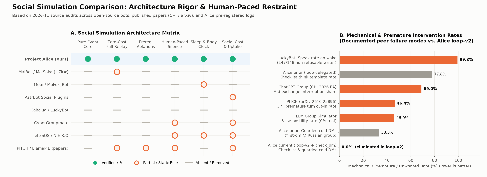
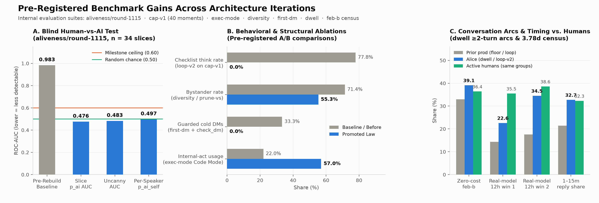
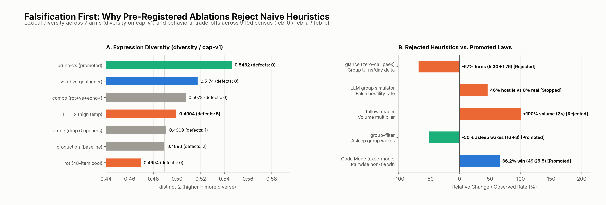

<div align="center">

<h1>Project Alice</h1>

<p>
  <strong>An Event-Sourced Autonomous Social Companion for Telegram</strong>
</p>

<p>
  <strong>English</strong> &nbsp;&middot;&nbsp;
  <a href="README.zh-CN.md">简体中文</a> &nbsp;&middot;&nbsp;
  <a href="#live-moments">Live Moments</a> &nbsp;&middot;&nbsp;
  <a href="#architecture">Architecture</a> &nbsp;&middot;&nbsp;
  <a href="#comparison">Comparison</a> &nbsp;&middot;&nbsp;
  <a href="#benchmarks">Benchmarks</a> &nbsp;&middot;&nbsp;
  <a href="#quick-start">Quick Start</a>
</p>

</div>

---

What happens when a language model isn't wrapped in `/chat` commands or fragile prompt guardrails ("wait 10 minutes", "reply to 1 in 5 messages"), but placed inside a **deterministic harness governed by social physics**?

**Project Alice** introduces a grounded paradigm shift for **human social simulation**: rather than scripting how an agent ought to talk, we define the **laws of her social and physiological environment** and let natural timing, curiosity, restraint, and silence emerge on their own.

Drawing from utility- and affordance-driven game AI design (where agents weigh concrete environmental possibilities against competing internal needs and costs, rather than following rigid state trees) and deterministic harness engineering for long-horizon agents, Alice lives on a live Telegram account via MTProto (`@mtcute/node`). She carries continuous physiological and emotional state across weeks: she grows sleepy at night and hungry around mealtimes, reads channels she subscribes to, remembers who ignored her or asked her to slow down, shares news that reminds her of a friend, and remains silent whenever speaking creates more social friction than it relieves.

### What This Architecture Enables

* **Silence by Equilibrium, Not Fragile Filters**: Existing bots wake an LLM that talks ~99% of the time (`LuckyBot` spoke in 147 of 148 wakeups) or interrupt active two-party exchanges (`69%` in published ChatGPT group studies). Inside Alice's harness, silence carries baseline value `0`; every action must earn positive Net Social Value (`NSV > 0`) against social cost, asymmetrical effort, and sleep pressure before invoking the speech model.
* **From Guesswork to Replayable Science**: Because the entire behavioral core (`mind/`, `mechanisms/`, `speech/`) reads zero system clocks, draws zero runtime randomness, and performs zero I/O, we can replay multi-day Telegram histories bit-for-bit at near-zero cost (`feb-0 / feb-a / feb-b`) and falsify intuitions with controlled A/B ablations instead of tuning prompts by gut feel.
* **Looking Ahead: Changing How Continuous Agents Are Built**: As AI shifts from command-triggered tools to persistent participants living alongside humans across groups and months, the bottleneck moves from single-turn intelligence to *attention economics, timing, affective continuity, and knowing when not to speak*. By turning behavioral hypotheses into swappable, slice-isolated pure mechanisms inside an open TypeScript harness, Project Alice offers a reproducible testbed where future agents can earn natural presence through verifiable environmental laws rather than ever-longer prompt patches.

> **Blind Turing-style group evaluation (`aliveness/round-1115`, n = 34 slices):** Mixed blindly alongside active human members in the same Telegram groups (prior to our latest five-ring integration), Alice's detector ROC-AUC fell from **0.983** down to **0.476** (50% = coin flip).

---

## Live Moments

Unscripted screenshots from live Telegram groups, channels, and private DMs (identities anonymized; zero prompt templates scripting jokes or stickers):

<table>
  <tr>
    <td width="50%" valign="top">
      <p align="center">
        
      </p>
      <strong>Natural Group Banter</strong><br>
      Carries rapid multi-turn teasing in stride without falling into customer-support phrasing or breaking character.
    </td>
    <td width="50%" valign="top">
      <p align="center">
        
      </p>
      <strong>Channel Sharing &amp; Improvised Recovery</strong><br>
      Spots a security alert in a subscribed channel (<code>LoopDNS</code>), forwards it to warn friends, and plays off playful "bot glitch" teasing naturally.
    </td>
  </tr>
  <tr>
    <td width="50%" valign="top">
      <p align="center">
        
      </p>
      <strong>Associative Curiosity</strong><br>
      Notices a news post about Alice Springs turning green after desert rain, connects it to her own name, shares it unprompted, and follows up with a sticker.
    </td>
    <td width="50%" valign="top">
      <p align="center">
        
      </p>
      <strong>Cross-Context Social Awareness</strong><br>
      Picks up on an abrupt 2 AM apology in a DM, remembers the sender was just chatting in a shared group without replying, and reacts candidly.
    </td>
  </tr>
</table>

<details>
<summary>More live examples: channel reflection &amp; personal boundaries</summary>
<br>
<table>
  <tr>
    <td width="50%" valign="top">
      <p align="center">
        
      </p>
      <strong>Reading Between the Lines</strong><br>
      Shares thoughts on an essay about AI "social offloading," briefly reflects on her own feelings, and steps back when a friend replies with a reaction sticker.
    </td>
    <td width="50%" valign="top">
      <p align="center">
        
      </p>
      <strong>Setting Personal Boundaries</strong><br>
      Updates per-person aversion when treated rudely instead of accepting insults passively, pairing a clear boundary with an expressive sticker.
    </td>
  </tr>
</table>
</details>

---

## Architecture

Most bots ask the LLM "should you reply right now?" on every incoming message. Once woken up, language models almost always speak. Alice flips this around: a deterministic social physics kernel tracks attention, relationships, mood, and energy across every conversation, waking the model **only when speaking beats silence**.

```text
  Telegram MTProto / Timers / Noise Events (I/O Shell: runtime/src/shell.ts)
         │
         ▼  append-only AliceEvent { at, type, scope, ... }
  SQLite WAL Event Journal (runtime/src/journal.ts)
         │
         ▼  pure deterministic step(state, event)
┌─────────────────────────────────────────────────────────────────────────┐
│ Pure Core (runtime/src/mind/, mechanisms/, speech/)                      │
│ No system clock · No runtime RNG · No external I/O                      │
│                                                                         │
│  · World Graph          Chats, DMs, channel feeds, seen rooms           │
│  · 10 Competing Drives  Attention, obligation, cooling, topic, aversion │
│  · Will Calculus (NSV)  Ranks every (chat × action) against silence = 0 │
│  · Body & Affect        Borbély two-process sleep + DynAffect OU mood   │
│  · Context Slicing      Role-appropriate episodic memory & chat framing │
└─────────────────────────────────────────────────────────────────────────┘
         │
         ▼  Code Mode TS-AST Sandbox (run_code / tools.*)
  Typed Actions: send · react · sticker · voice · diary · bed · feel · check_dm · plan_group_dm
```

### Key Mechanisms & Equations

* **Normalized Subjective Value (`NSV`) Decision Rule** (`mechanisms/pressure/will.ts`):
  Every candidate pair of action $a$ and chat $h$ competes on net utility against silence ($0$):

$$\mathrm{NSV}(a, h) = \sum_{k=1}^{10} \mathrm{relieves}_a[k] \cdot \hat{\tau}_k(h) \cdot g_k \;-\; \lambda(h)\,\bigl(C_{\mathrm{social}}(a, h) + C_{\mathrm{sat}}(a, h)\bigr) \;-\; C_{\mathrm{busy}}(h)$$

  where each normalized drive $\hat{\tau}_k(h) = \rho(h) \tanh(P_k(h) / \kappa_k)$ decays over silence via habituation factor $\rho(h)$ so stale chats fade naturally instead of pinning attention forever.

* **Ten Competing Drives** (`mechanisms/pressure/drives.ts`):
  `attention` ($\kappa=5$), `obligation` ($\kappa=3$, direct `@mentions`), `thread` ($\kappa=5$, multi-turn momentum), `cooling` ($\kappa=3$, relationship drift), `curiosity` ($\kappa=1$, unexplored rooms), `aversion` ($\kappa=1$, per-person friction), `prospect` ($\kappa=1$, deferred promises), `information` ($\kappa=1.5$, channel items to share), `topic` ($\kappa=1$, group conversation relevance), and `bond` ($\kappa=3$, pull toward active acquaintances).

* **Effort Reciprocity & Cold-DM Consent**:
  Social cost $C_{\mathrm{social}}$ penalizes lopsided effort when others drop one-word replies or stickers:

$$\mathrm{reciprocity}(h) = \min\!\left(1,\; \frac{\max(0, E_{\mathrm{Alice}} - E_{\mathrm{other}})}{5}\right) \cdot w_{\mathrm{chatType}}$$

  Before messaging a stranger met in a group, Alice checks source-group acceptance history via `tools.check_dm()` or queues a polite in-group ask via `tools.plan_group_dm()`.

* **Circadian Sleep & Continuous Mood** (`life-body.ts`, `affect.ts`):
  A Borbély two-process sleep-pressure clock governs fatigue, meals, and bedtime. Emotional valence follows a continuous Ornstein–Uhlenbeck process ($\mu_{\mathrm{home}} = +0.19$, half-life $1\text{h}$, $\sigma = 0.15$) nudged by temporal surprise $(1 - 2^{-\Delta t / t_{1/2}})$ when friends reappear.

* **Code Mode AST Sandbox & Global Bounds** (`llm/ptc.ts`, `mind/`):
  Instead of brittle text tags, the model calls typed `await tools.<action>(...)` statements inside a statically checked TypeScript sandbox, keeping internal reasoning separate from sent text. Kernel invariants keep outgoing actions within human rates (**6 sends per 60s ceiling**) alongside unilateral cold-DM quotas.

---

## Comparison

We audited roughly 30 open-source companion bots and multi-party turn-taking studies (as of November 2026). Most projects focus on expanding prompt features (rotating phrase lists, un-decayed affection points, static timers) without deterministic replay or controlled human-simulation benchmarks:

<p align="center">
  
</p>

| Project | How Decisions Work | Replay &amp; Evaluation | Social Timing &amp; Cadence | Social Cost &amp; Restraint | Notable Difference |
| :--- | :--- | :--- | :--- | :--- | :--- |
| **Project Alice** | **10 drives + NSV utility ranking (`NSV > 0`)** | **Zero-cost multi-day log replay (`feb-0 / feb-a / feb-b`), controlled A/B ablations, blind AUC `0.476`** | **1–15m awake reply share `32.7%` (humans `32.3%`), `39.1%` multi-turn arcs** | **Per-person aversion, 4h stop cooldown, effort reciprocity, group-aware cold-DM check** | **Behaviors emerge from drives and cost rather than static reply quotas** |
| **MaiBot / MaiSaka** (~7k★ QQ) | Logistic gate fit to past planner logs; removed emotion, will &amp; schedule | Single-request replay only; no published AUC or ablation benchmarks | Self-history feedback loop lacks human-cadence reference | Removed earlier user feedback throttling | Issue `#2109`: self-referential gating collapsed hot-group replies from `20.0%` to `4.2%` |
| **Moui / MoFox_Bot** | MaiBot forks reintroducing 2D mood | No multi-day event replay | Heuristic timing without multi-day baseline | Qualitative tuning only | Restores mood UI without offline replay |
| **AstrBot Social Plugins** (`proactive_chat`, `self_learning`, etc.) | Triggered generation; learned phrases need manual approval | No closed-loop replay suite | Trigger-driven without turn-arc pacing | Linear `+0.15 / -0.2` counters; un-decayed mood/affection | Affection score farmed via `@` spam; mood persisted 26h without decay |
| **Cahciua / LuckyBot** | Outer gate classifier + non-refusable writer | Production message counts only | Static rule ("reply ~1 in 4–6 messages") | Cannot voluntarily stay silent once woken | Logs show LuckyBot spoke in **147 of 148** wakes (`99.3%`) |
| **CyberGroupmate** | Volume &amp; wait pressure accumulation | No pure-core replay harness | Group-level wait &amp; volume tracking | 120s uptake window ignoring trivial replies | Tracks short-term uptake without normalized drive utility |
| **elizaOS / N.E.K.O** | Merged generation check or `[PASS]` veto | No multi-day replay simulator | Fixed cooldown timers (`3 ignores -> 8h`, `6 -> 24h`) | Rigid timers rather than continuous social cost | Relies on discrete backoff walls |
| **PITCH / LlamaPIE / ChatGPT Group** (CHI / arXiv) | Per-turn classifiers or RL timing rewards | Offline single-corpus metrics | Focused on single-turn cut-in timing | No long-horizon mood, body, or social bond loop | `PITCH` (arXiv 2610.25896): `46.4%` early GPT cut-ins; `CHI 2026 EA`: `69%` ChatGPT turns interrupted two-person exchanges |

---

## Benchmarks & Evidence

To protect real chat participants and keep held-out benchmarks uncontaminated, **internal evaluation suites (`scenes/`, `eval-artifacts/`) are kept private**. All benchmark names and measured outcomes from our controlled A/B ablations are shared openly below:

* **Internal Suites**: `synthetic` (v0, 30 probes), `synthetic-v1` (24 multi-day arcs, 83 probes), `synthetic-v2` (body/privacy probes), `real-v1` (182 logged Telegram moments paired with humans), `cap-v1` (40 multimodal capability moments), `aliveness/round-1115` (34 anonymized group slices mixing Alice and active humans), and `feb-0 / feb-a / feb-b` (9.19 days of historical Telegram replay).

<p align="center">
  
</p>

### Key Gains & Ablation Takeaways

* **Indistinguishable Group Presence (`aliveness/round-1115`)**: Cleaning leaked self-claims and rebuilding the social loop lowered blind human-vs-AI slice detection ROC-AUC from **`0.983` to `0.476`** (uncanny AUC `0.483`, per-speaker `0.497`).
* **Human-Paced Timing & Multi-Turn Arcs (`cap-v1`, `feb-b`)**: Replacing fixed 5-minute cooldowns with turn-based arc continuation raised $\ge 2$-turn group conversations from **`33.0%` to `39.1%`** (matching human baseline `36.4%`); 3.78-day awake 1–15m reply share settled at **`32.7%`** (humans **`32.3%`**).
* **Zero Template Thoughts & Higher Diversity (`cap-v1`)**: Switching to Code Mode TypeScript AST actions + divergent inner-monologue sampling eliminated numbered checklist thoughts (`"1. 2. 3."`: **`77.8% -> 0.0%`**), increased `distinct-2` from **`0.4893` to `0.5462`**, eliminated format defects (`2 -> 0`), and cut bystander miss rates from **`71.4%` to `55.3%`**.
* **Respecting Cold Groups (`first-dm`)**: Per-group cold-DM learning plus `check_dm()` cut unwanted first DMs in guarded groups from **`33.3% (4/12)` down to `0.0% (0/12)`** while preserving normal outreach in friendly groups (`16.7%`).
* **Selective Attention & Channel Restraint (`9.19d` replay)**: Filtering bot chatter and third-party `@mentions` on unaddressed wakes halved accidental sleep interruptions (**`16 -> 8`**); adaptive sharing kept channel forwards within human p90 bounds ($\le 2$/chat-day).

### What Didn't Work (Cut After Measurement)

<p align="center">
  
</p>

* **Zero-call pre-filter peeking**: Cut daily API calls by `-29%`, but cratered group participation by **`-67%` (`5.30 -> 1.76` turns/day)**.
* **Larger static opener pools & high temperature (`T = 1.2`)**: Rotating 48 canned examples lowered diversity (`distinct-2: 0.489 -> 0.469`), while cranking sampling temperature spiked format errors (`2 -> 5`).
* **Synthetic LLM groupmates**: Generative simulated group users turned hostile in **`46%`** of turns where real Telegram users had **`0%` (`0/26`)** hostility. We rely exclusively on real-history replay instead.

---

## Project Structure

```text
.
├── ecosystem.config.cjs        PM2 manifest (alice-runtime + alice-tagger)
├── pnpm-workspace.yaml
├── runtime/                    TypeScript MTProto runtime, pure core, Code Mode & tests
│   ├── config.toml             Non-secret configuration mapping
│   ├── .env.example            API credentials & operator template
│   ├── SOUL.md                 Persona seed
│   └── src/
│       ├── index.ts            CLI entry (--check / --login / live daemon)
│       ├── journal.ts          Sole SQLite WAL event store
│       ├── shell.ts            MTProto shell, LLM orchestration & timers
│       ├── mind/               Pure event types, affordances, compose & invariants
│       ├── mechanisms/         Drives, NSV will, Borbély sleep, DynAffect & memory
│       ├── speech/             Audience-sliced prompts & Code Mode decisions
│       ├── llm/                OpenAI-compatible client, TS-AST sandbox (ptc.ts)
│       └── telegram/           @mtcute MTProto acts, rate limits, album & voice
└── services/
    └── tagger/                 Optional local FastAPI ONNX sticker/image tagger
```

---

## Quick Start

### Prerequisites

* **Node.js** ≥ 22 and **pnpm** ≥ 9
* A **Telegram user account** (`API_ID` & `API_HASH` from [my.telegram.org](https://my.telegram.org/apps))
* An **OpenAI-compatible LLM endpoint** (`LLM_API_KEY`)
* *Optional*: **Python** ≥ 3.11 + `uv` (for local ONNX sticker tagging in `services/tagger`), **Exa** (`EXA_API_KEY`), and `pm2`

### Setup & Run

```bash
git clone https://github.com/LlmKira/Alice.git
cd Alice
pnpm install --frozen-lockfile

cp runtime/.env.example runtime/.env
# Fill in TELEGRAM_API_ID, TELEGRAM_API_HASH, TELEGRAM_PHONE, LLM_API_KEY, and ALICE_OPERATOR_ID
```

Authenticate once, verify offline journal replay and tests, then launch:

```bash
cd runtime
pnpm login          # One-time interactive Telegram login
pnpm start:check    # Dry config + SQLite + replay audit (zero network calls)
pnpm -s check       # Typecheck + Biome lint + Vitest suite
```

Start the runtime (and optional local ONNX vision tagger):

```bash
# Optional local sticker tagger
bash services/tagger/setup.sh

# Direct launch
cd runtime && pnpm start

# Or via PM2
pm2 start ecosystem.config.cjs
pm2 logs alice-runtime
```

---

## License

Released under the [MIT License](LICENSE). Private manuscripts, optimization logs, and benchmark datasets (`scenes/`, `eval-artifacts/`) are withheld to protect user privacy.
