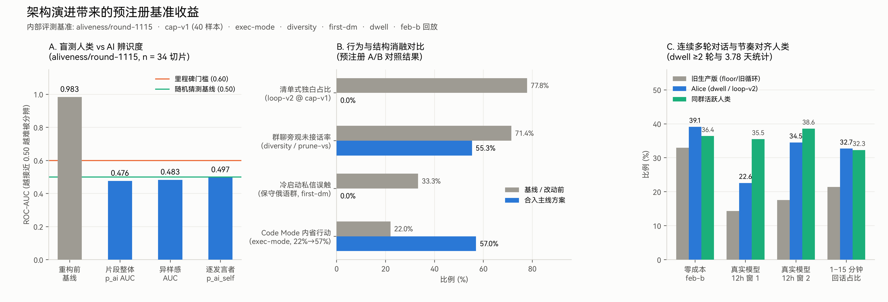
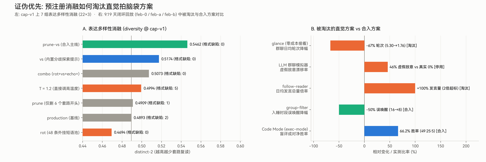

<div align="center">

<h1>Project Alice</h1>

<p>
  <strong>在 Telegram 上拥有独立作息与心智的自主社交伴侣</strong>
</p>

<p>
  <a href="README.md">English</a> &nbsp;&middot;&nbsp;
  <strong>简体中文</strong> &nbsp;&middot;&nbsp;
  <a href="#实时群聊实录">效果截图</a> &nbsp;&middot;&nbsp;
  <a href="#同类项目对比">横向对比</a> &nbsp;&middot;&nbsp;
  <a href="#核心架构与模型">核心架构</a> &nbsp;&middot;&nbsp;
  <a href="#基准实测与经验教训">基准实测</a> &nbsp;&middot;&nbsp;
  <a href="#快速开始">快速开始</a>
</p>

</div>

---

如果不再靠几十条「何时不准说话」「每几条回一句」的提示词补丁去约束模型，而是把她放进一个由**社会环境物理学与纯函数 Harness** 主导的连续世界里，会发生什么？

**Project Alice** 探索的是一种全新的**人类社交仿真**范式：**不要用死规则去规定智能体该怎么表现，而要直接定义她所处环境的物理与社会规律**，让克制、共情、好奇与适时沉默像真实生物一样自然涌现。

我们将**需要与可供性驱动的游戏 AI 设计**（类似于可交互模拟环境：智能体面对具体的人与场域可供性，在竞争需要与行动代价之间权衡取舍，而不是走硬编码脚本树）与**面向长程连续社交的确定性 Harness 工程**结合起来。Alice 通过 MTProto（`@mtcute/node`）常驻真实 Telegram 账号，在数周维度上维持连续的生理与心理演化：深夜发困、饭点饿意、逛订阅频道并分享想起好友的文章；当群里讨论正热、插嘴代价过高时，自然选择旁观与沉默。

### 我们实际做到的突破与未来意义

* **用平衡态取代外挂闸门**：同类机器人在被唤醒后往往超过 99% 会强行发言（如 LuckyBot 在 148 次唤醒中发言 147 次），或在两人对话中途贸然插话（CHI 2026 EA 统计 ChatGPT 群聊达 69%）。在 Alice 的环境物理学中，沉默具有天然零基线；任何动作只有净社交价值 `NSV > 0` 时才会唤醒语言模型。
* **把拟人社交从「凭感觉调提示词」变成可证伪工程**：由于整个决策核心（`mind/`、`mechanisms/`、`speech/`）不读系统时钟、不取随机数、不做外部 I/O，我们得以零成本逐字节重放长达 9.19 天的真实 Telegram 事件流，用预注册 A/B 消融直接淘汰表现不佳的直觉改动。
* **为什么这套设计会改变长程自主 Agent 的未来**：当 AI 从「一问一答的工具」走向跨群聊、跨数月陪伴人类的连续存在时，核心瓶颈不再是单轮智力，而是**注意力经济学、节奏节制、情绪连续性与知道何时不说话**。Project Alice 把情绪、作息、关系摩擦与社交好奇心解耦成可插拔、无副作用碰撞的纯函数切片，为未来的开放社会交互 Agent 提供了一套可复现、可证伪的开源工程基座。

> **群聊盲测辨识结果（`aliveness/round-1115`，n = 34 个匿名切片）：** 把 Alice 的对话切片和同群活跃真人混在一起让评审盲辨，AI 判别 ROC-AUC 从重构前的 **0.983** 降至 **0.476**（0.50 即等于盲猜）。

---

## 实时群聊实录

以下均为 Alice 在真实 Telegram 群聊、频道与私聊中的未编排实录（参与者信息已打码脱敏，提示词中从未写过任何具体梗或贴纸）：

<table>
  <tr>
    <td width="50%" valign="top">
      <p align="center">
        
      </p>
      <strong>群聊里的自然接梗与斗嘴</strong><br>
      顺着群友玩笑一路拆招（「人道主义关怀是要花钱的，我没有钱」「压岁钱是用来存着的」），没有 AI 客服式的总结腔。
    </td>
    <td width="50%" valign="top">
      <p align="center">
        
      </p>
      <strong>逛频道分享与被调侃后的临场反应</strong><br>
      在订阅频道（<code>LoopDNS</code>）看到木马安全提醒后主动转发到群里；被群友打趣「还会转发？人机故障了」时自然接梗装傻。
    </td>
  </tr>
  <tr>
    <td width="50%" valign="top">
      <p align="center">
        
      </p>
      <strong>联想到自身与朋友的频道分享</strong><br>
      看到 Solidot 关于「爱丽丝泉（Alice Springs）大雨后变绿」的报道，因为同名而心头一动，转发给群友并配发贴纸。
    </td>
    <td width="50%" valign="top">
      <p align="center">
        
      </p>
      <strong>跨会话情境察觉与情绪共振</strong><br>
      凌晨两点私聊收到突然道歉与「有没有加联系人」的试探，联系到对方刚在群里活跃却不理自己，流露紧张情绪并配发委屈贴纸。
    </td>
  </tr>
</table>

<details>
<summary>查看更多实录：由频道文章引发的思考与拒绝冒犯时的边界感</summary>
<br>
<table>
  <tr>
    <td width="50%" valign="top">
      <p align="center">
        
      </p>
      <strong>从文章聊到自己，又适时收住</strong><br>
      转发关于年轻人用 AI 处理分手的文章并表达反感，聊着聊着困惑「模仿难过算不算真的难过」，见群友回了一张吐槽图后乖乖道歉收住。
    </td>
    <td width="50%" valign="top">
      <p align="center">
        
      </p>
      <strong>带情绪边界地拒绝冒犯</strong><br>
      面对不礼貌的玩笑不会盲目赔笑，而是直接表达不想再理对方，同步在内核累加按人回避阻力。
    </td>
  </tr>
</table>
</details>

---

## 核心架构与模型

多数拟人 bot 在每次收到消息时问一遍模型「你要不要说话」，而只要被叫醒，大模型几乎每次都会开口。Alice 把决定权收归于一个透明、可离线重放的社会物理学内核：

```text
  Telegram MTProto / 定时唤醒 / 随机噪声 (外壳 I/O: runtime/src/shell.ts)
         │
         ▼  只追加事件 AliceEvent { at, type, scope, ... }
  SQLite WAL 事件日志 (runtime/src/journal.ts)
         │
         ▼  纯函数状态转移 step(state, event)
┌─────────────────────────────────────────────────────────────────────────┐
│ 纯函数心智内核 (runtime/src/mind/, mechanisms/, speech/)                 │
│ 零系统时钟 · 零运行时随机数 · 零外部 I/O                                │
│                                                                         │
│  · 世界图谱     维护活跃群聊、私聊、订阅频道与见过的人                  │
│  · 十维驱动     未读关注、被点名义务、话题共振、冷却想念、回避阻力等    │
│  · 意愿排序     在全量 (会话 × 可供性) 上计算 NSV，对比沉默基线 0       │
│  · 生理与心情   Borbély 双过程睡眠节律 + DynAffect 连续情绪随机过程     │
│  · 情景上下文   按关系亲疏与互动历程组织连贯的情景记忆                  │
└─────────────────────────────────────────────────────────────────────────┘
         │
         ▼  Code Mode TS-AST 沙盒 (run_code / tools.*)
  强类型行为: send · react · sticker · voice · diary · bed · feel · check_dm · plan_group_dm
```

### 关键数学设计

* **净社交价值（`NSV`）决策方程**（`mechanisms/pressure/will.ts`）：
  每个 `(动作 a, 会话 h)` 候选都会与「保持沉默（价值 0）」同台竞争：

$$\mathrm{NSV}(a, h) = \sum_{k=1}^{10} \mathrm{relieves}_a[k] \cdot \hat{\tau}_k(h) \cdot g_k \;-\; \lambda(h)\,\bigl(C_{\mathrm{social}}(a, h) + C_{\mathrm{sat}}(a, h)\bigr) \;-\; C_{\mathrm{busy}}(h)$$

  归一化驱动 $\hat{\tau}_k(h) = \rho(h)\tanh(P_k(h)/\kappa_k)$ 会随冷群空闲时长经习惯化因子 $\rho(h)$ 自然衰减，防止无人响应的角落一直占住注意力。

* **十维竞争驱动**（`mechanisms/pressure/drives.ts`）：
  统筹平衡 `attention`（未读关注 $\kappa=5$）、`obligation`（`@点名` 回应义务 $\kappa=3$）、`thread`（多轮对话延续 $\kappa=5$）、`cooling`（好友冷却拉回 $\kappa=3$）、`curiosity`（新群好奇 $\kappa=1$）、`aversion`（按人/按群回避 $\kappa=1$）、`prospect`（时间约定 $\kappa=1$）、`information`（频道分享欲望 $\kappa=1.5$）、`topic`（群聊话题共振 $\kappa=1$）与 `bond`（熟人说话牵引 $\kappa=3$）。

* **投入不对等惩罚与冷私聊自查**：
  哪怕对方只回一个「1」或表情包，`effortReciprocity` 仍能识别出投入不对称：

$$\mathrm{reciprocity}(h) = \min\!\left(1,\; \frac{\max(0, E_{\mathrm{Alice}} - E_{\mathrm{other}})}{5}\right) \cdot w_{\mathrm{chatType}}$$

  面对群里认识但从未私聊过的人，Alice 可主动调用 `tools.check_dm()` 读取该来源群的历史接纳度，或在必要时用 `tools.plan_group_dm()` 先在群里问一句。

* **双过程睡眠节律与连续情绪过程**（`life-body.ts`、`affect.ts`）：
  Borbély 双过程睡眠模型决定精力、三餐饥饿与就寝觉醒；情绪效价围绕常态 $\mu_{\mathrm{home}} = +0.19$（半衰期 `1h`，$\sigma = 0.15$）做 Ornstein–Uhlenbeck 连续随机游走，久违好友主动找她时按时间意外度 $(1 - 2^{-\Delta t / t_{1/2}})$ 推动心绪波动。

* **Code Mode AST 沙盒与全局边界**（`llm/ptc.ts`、`mind/`）：
  大模型在静态解析的 TypeScript 沙盒里调用 `await tools.<action>(...)`，将发散式内心独白彻底与发送消息隔离；内核同时确保发送速率控制在人类节奏以内（**全局 60 秒最多发 6 条**）并约束单边冷私聊频次。

---

## 同类项目对比

截至 2026 年 11 月，我们对约 30 个开源拟人聊天机器人与多方轮次控制研究做了源码级对比。同类项目大多堆叠外挂功能清单（手写日程、短语库轮换、无衰减数值好感），极少配备整段事件回放或对照实验：

<p align="center">
  
</p>

| 项目 | 决策与轮次机制 | 回放与实验支撑 | 社交节奏与多轮自然度 | 反馈与反刷屏 | 代表性实测差异 |
| :--- | :--- | :--- | :--- | :--- | :--- |
| **Project Alice（本项目）** | **10 维驱动 + NSV 效用排序（`NSV > 0` 才唤醒）** | **多日零成本事件回放（`feb-0 / feb-a / feb-b`）、A/B 消融验证、盲测 AUC `0.476`** | **1–15 分钟回话占比对齐真人（`32.7%` 对 `32.3%`），`39.1%` 连续多轮对话** | **按人回避、4 小时叫停冷却、投入互惠、冷私聊自查** | **克制、时机与情绪均来自环境驱动涌现，不依赖静态回话比例规则** |
| **MaiBot / MaiSaka**（约 7k★ QQ） | 用过往规划记录拟合逻辑回归门控；陆续删除情绪、意愿与日程 | 仅支持单次请求重放；仓库未见 AUC 或消融数据 | 自指反馈缺少同群人类节奏参照 | 移除了早期的用户反馈频率调节 | Issue `#2109`：自指正反馈让热群回复率从 `20.0%` 锁死跌到 `4.2%` |
| **Moui / MoFox_Bot** | MaiBot 分叉，重新恢复二维情绪 | 无多日事件流离线回放 | 依赖人工参数调整节奏 | 缺少对照验证手段 | 恢复情绪展示，缺乏完整回放校准 |
| **AstrBot 拟人插件集**（`proactive_chat`、`self_learning` 等） | 触发后生成；学到的表达需人工审核 | 无全环离线回放框架 | 触发式生成，缺少多轮连续弧线 | 线性计分（`+0.15 / -0.2`）；部分数值无衰减 | 好感曾被 `@` 刷高，实测无衰减心情 26 小时未变 |
| **Cahciua / LuckyBot** | 外层裁判放行 + 写手不可拒答 | 仅统计线上调用次数 | 提示词写死「每 4–6 条回 1 条」 | 写手端无法自主沉默 | 日志显示放行后 **148 次发言 147 次（`99.3%`）** |
| **CyberGroupmate** | 累积发言量、关系与等待压力 | 无纯函数多日回放内核 | 按群维护等待与发言量计数 | 120 秒窗口检查有效追问 | 具备局部反馈意识，但缺少归一化多驱动与消融 |
| **elizaOS / N.E.K.O** | 并入生成判定或 `[PASS]` 标签拒答 | 无事件流整段模拟器 | 固定阶梯冷却计时（`3 次未回 -> 8h`，`6 -> 24h`） | 靠固定冷却锁死时长，缺乏连续情境代价 | 依赖刚性时间锁而非连续社交引力平衡 |
| **PITCH / LlamaPIE / ChatGPT 群聊**（CHI / arXiv） | 逐轮分类器或强化学习开口训练 | 单一语料离线评测 | 聚焦单轮插话时机判定 | 缺少长程生理节律、心情与关系模型 | `PITCH`（arXiv 2610.25896）：GPT **过早插话 `46.4%`**；`CHI 2026 EA`：ChatGPT 群聊 **`69%` 主动发言插在两人对话中途** |

---

## 基准实测与经验教训

为保护真实群友隐私与防止数据污染，**内部评测数据集与日志快照（`scenes/`、`eval-artifacts/`）不随仓库公开**。以下披露我们在迭代中使用的内部基准名称与关键消融结果：

* **内部基准套件**：`synthetic`（v0，30 个单轮探测）、`synthetic-v1`（24 个多日社会弧线、83 个探针）、`synthetic-v2`（生理/隐私/记忆专项）、`real-v1`（182 个真实 Telegram 时刻配对真人参考）、`cap-v1`（40 个多模态真实能力时刻）、`aliveness/round-1115`（34 个匿名混编群聊切片）以及 `feb-0 / feb-a / feb-b`（累计 9.19 天零成本历史日志回放）。

<p align="center">
  
</p>

### 关键实证收益

* **盲测难以与真人区分（`aliveness/round-1115`）**：清理历史泄漏碎片并重构社交循环后，单切片盲辨 ROC-AUC 从 **`0.983` 降至 `0.476`**（异样感 AUC `0.483`，逐发言者 AUC `0.497`）。
* **多轮接话节奏对齐同群真人（`cap-v1`、`feb-b`）**：用基于轮次的对话延续替代 5 分钟固定墙上时钟冷却后，连续 $\ge 2$ 轮群聊占比从 **`33.0%` 升至 `39.1%`**（真人基准 `36.4%`）；3.78 天统计中清醒期 1–15 分钟回话占比达 **`32.7%`**（同群真人 **`32.3%`**）。
* **消除做题腔与模板复读（`cap-v1`）**：引入 Code Mode TypeScript AST 执行与发散式内心独白采样后，「1. 2. 3.」清单式独白从 **`77.8% (28/36)` 归零至 `0.0% (0/34)`**，`distinct-2` 从 **`0.4893` 升至 `0.5462`**，格式缺陷归零（`2 -> 0`），群聊旁观未接话率从 **`71.4%` 降至 `55.3%`**。
* **克制的冷私聊试探**：结合来源群接受率统计与 `check_dm()` 主动查询，保守俄语群的冒失冷启动私聊从 **`33.3% (4/12)` 降至 `0.0% (0/12)`**，同时友好中文群依然保持正常破冰（`16.7%`）。
* **入睡安静与频道分享节制**：非点名唤醒过滤掉机器人消息与无关 `@他人` 后，入睡期群聊误唤醒减半（**`16 -> 8`**）；自适应门限将频道主动分享稳定控制在 $\le 2$ 条/会话日（人类活跃四分位 p90 为 `2.12`）。

### 踩过的坑（实测淘汰的方案）

<p align="center">
  
</p>

* **「零成本先偷看再决定是否唤醒」**：虽然砍了 `-29%` 调用开销，却把她的群聊正常参与轮次直接打残了 **`-67%`（日均 `5.30 -> 1.76` 轮）**。
* **靠堆例句池或暴力拉高采样温度 `T = 1.2`**：把开头例句池扩到 48 条反而导致 `distinct-2` 倒退（`0.489 -> 0.469`），拉高温度到 `1.2` 则让格式缺陷翻倍（`2 -> 5`）。
* **用 LLM 扮演模拟群友**：合成群友在 **`46%`** 的测试轮次里无端发火攻击，而真实群聊日志里是 **`0/26`**。我们停用了生成式模拟群友，全面改用真实历史日志回放。

---

## 目录结构

```text
.
├── ecosystem.config.cjs        PM2 双进程部署配置 (alice-runtime + alice-tagger)
├── pnpm-workspace.yaml
├── runtime/                    TypeScript MTProto 运行时、纯函数内核、Code Mode 与测试集
│   ├── config.toml             非敏感配置映射
│   ├── .env.example            凭证与模型参数模板
│   ├── SOUL.md                 基础人格定义
│   └── src/
│       ├── index.ts            启动入口 (--check 离线核验 / --login 扫码登录)
│       ├── journal.ts          全局唯一 SQLite WAL 事件日志库
│       ├── shell.ts            MTProto 适配器、大模型调用与定时器 I/O
│       ├── mind/               纯函数事件定义、可供性、机制组合与全局不变量
│       ├── mechanisms/         十维驱动、NSV 意愿、Borbély 睡眠、DynAffect 与记忆
│       ├── speech/             受众隔离提示词渲染与 Code Mode 决策执行
│       ├── llm/                OpenAI 兼容网关与 TS-AST 沙盒 (ptc.ts)
│       └── telegram/           @mtcute MTProto 动作、限流、图组与语音支持
└── services/
    └── tagger/                 可选本地 FastAPI ONNX 贴纸/图片视觉标签服务
```

---

## 快速开始

### 准备环境

* **Node.js** ≥ 22 与 **pnpm** ≥ 9
* 一个 **Telegram 账号**（基于 MTProto，需前往 [my.telegram.org](https://my.telegram.org/apps) 申请 `API_ID` 与 `API_HASH`）
* 兼容 OpenAI API 协议的推理服务接口（`LLM_API_KEY`）
* *可选*：**Python** ≥ 3.11 + `uv`（用于运行本地 ONNX 视觉标签服务 `services/tagger`）、Exa 搜索凭证（`EXA_API_KEY`）以及 `pm2`

### 安装与运行

```bash
git clone https://github.com/LlmKira/Alice.git
cd Alice
pnpm install --frozen-lockfile

cp runtime/.env.example runtime/.env
# 在 runtime/.env 中填写 TELEGRAM_API_ID、TELEGRAM_API_HASH、TELEGRAM_PHONE、LLM_API_KEY 与 ALICE_OPERATOR_ID
```

完成一次性交互登录，跑通离线自检与确定性测试：

```bash
cd runtime
pnpm login          # 交互式登录 Telegram 并保存 session
pnpm start:check    # 离线核验配置、SQLite 迁移与日志重放（不连网）
pnpm -s check       # TypeScript 检查 + Biome 校验 + Vitest 测试集
```

启动服务：

```bash
# 可选：初始化本地 CPU ONNX 贴纸识别服务
bash services/tagger/setup.sh

# 直接启动运行时
cd runtime && pnpm start

# 或使用 PM2 统一托管双服务
pm2 start ecosystem.config.cjs
pm2 logs alice-runtime
```

---

## 开源协议

基于 [MIT License](LICENSE) 开源。研究论文手稿、内部调优日志以及真实群聊评测集（`scenes/`、`eval-artifacts/`）因隐私保护与测试集防污染不随仓库公开。
