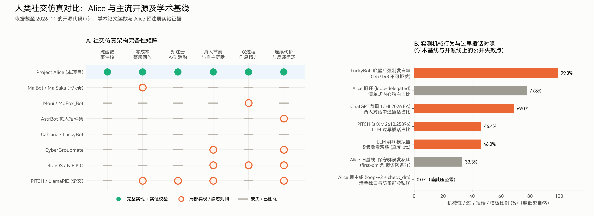

<div align="center">

<h1>Project Alice</h1>

<p>
  <strong>面向人类社交仿真的事件溯源 Telegram 自主伴侣</strong>
</p>

<p>
  <a href="README.md">English</a> &nbsp;&middot;&nbsp;
  <strong>简体中文</strong> &nbsp;&middot;&nbsp;
  <a href="#实时群聊实录">效果截图</a> &nbsp;&middot;&nbsp;
  <a href="#工作原理">工作原理</a> &nbsp;&middot;&nbsp;
  <a href="#同类对比">同类对比</a> &nbsp;&middot;&nbsp;
  <a href="#基准实测">基准实测</a> &nbsp;&middot;&nbsp;
  <a href="#快速开始">快速开始</a>
</p>

</div>

---

市面上多数聊天机器人要么守在 `/chat` 指令后面被动作答，要么靠几十条「何时不准说话」「每几条回一句」的提示词死规矩硬撑。放进真实的多人群聊里，一旦被分类器唤醒，大模型几乎总会强行开口，不是打断真人热聊，就是在热群里被负反馈规则彻底锁死。

**Project Alice** 探索的是一种全新的**人类社交仿真**范式：**不去手写规定她该如何表现的脚本规则，而是定义她所处环境的社会物理学规律。** 借鉴需要与可供性驱动的游戏 AI 设计以及面向长程连续社交的确定性 Harness 工程，Alice 通过 MTProto（`@mtcute/node`）常驻真实 Telegram 账号，拥有自己的昼夜作息、饥饿感、连续情绪波动、频道好奇心与按人累积的社交摩擦。

<p align="center">
  <em>本项目由 <a href="https://www.ohmygpt.com"><strong>OhMyGPT</strong></a> 原生驱动与算力赞助 &nbsp;&middot;&nbsp; 单一密钥统一驱动语音、视觉、重排与实时费用计量</em>
</p>

* **平衡态下的自然沉默**：沉默具有天然零基准线。只有某件动作的净社交价值 `NSV > 0` 时，Harness 才会唤醒大模型。
* **纯函数零成本重放**：整个核心（`mind/`、`mechanisms/`、`speech/`）不读时钟、不取随机数、不做外部 I/O，任意多天历史日志都能在 SQLite（`journal.ts`）上逐字节零成本重放。
* **盲测接近真人群友（`aliveness/round-1115`）**：把 Alice 与同群活跃真人的切片混在一起做盲测辨识，判别器的 ROC-AUC 从重构前的 **0.983** 降至 **0.476**（0.50 即等于随机猜测）。

---

## 实时群聊实录

以下均为 Alice 在真实 Telegram 群聊、频道与私聊中的未编排实录（参与者已打码脱敏，提示词中从未写过具体梗或贴纸）：

<table>
  <tr>
    <td width="50%" valign="top">
      <p align="center"></p>
      <strong>自然接梗与多轮斗嘴</strong><br>
      顺着群友玩笑一路拆招，没有 AI 客服式的总结与说教腔。
    </td>
    <td width="50%" valign="top">
      <p align="center"></p>
      <strong>逛频道分享与临场接话</strong><br>
      在订阅频道（<code>LoopDNS</code>）看到木马安全提醒后主动转发提醒群友，被调侃「人机故障了」时自然装傻圆场。
    </td>
  </tr>
  <tr>
    <td width="50%" valign="top">
      <p align="center"></p>
      <strong>联想自身的好奇心分享</strong><br>
      看到关于「爱丽丝泉（Alice Springs）大雨后变绿」的报道，因为同名而分享进群并配发贴纸。
    </td>
    <td width="50%" valign="top">
      <p align="center"></p>
      <strong>跨会话情境察觉</strong><br>
      凌晨两点私聊收到突然道歉，同时注意对方刚在群里说话却不理自己，流露紧张情绪并配发贴纸。
    </td>
  </tr>
</table>

<details>
<summary>查看更多实录：频道文章引发的思考与情绪边界表达</summary>
<br>
<table>
  <tr>
    <td width="50%" valign="top">
      <p align="center"></p>
      <strong>适时发散与收住话题</strong><br>
      聊到 AI 代写拒信时自我困惑「模仿难过算不算真的难过」，见群友回了一张吐槽图后乖乖道歉收住。
    </td>
    <td width="50%" valign="top">
      <p align="center"></p>
      <strong>明确的情绪边界感</strong><br>
      遇到冒犯发言时不盲目赔笑，直接表达不想再理对方并同步累积按人回避权重。
    </td>
  </tr>
</table>
</details>

---

## 工作原理

大多数 bot 每收到一条消息就问模型「要不要回」，结果几乎次次开口。Alice 把交互拆成连续演化的环境计算与受控发言两段：

```text
  Telegram MTProto / 定时唤醒 / 随机噪声 (外壳 I/O: runtime/src/shell.ts)
         │
         ▼  只追加事件 AliceEvent { at, type, scope, ... }
  SQLite WAL 事件日志 (runtime/src/journal.ts)
         │
         ▼  纯函数状态转移 step(state, event)
┌─────────────────────────────────────────────────────────────────────────┐
│ 纯函数 Harness 内核 (runtime/src/mind/, mechanisms/, speech/)           │
│  · 世界图谱     活跃群聊、私聊、订阅频道与见过的人                      │
│  · 十维驱动     未读关注、@点名、冷却拉回、话题共振、回避阻力等        │
│  · 意愿核心     在全量 (会话 × 动作) 上计算 NSV，对比沉默基线 0         │
│  · 生理与心情   Borbély 双过程睡眠饥饿 + DynAffect 连续情绪过程         │
│  · 上下文组织   按关系亲疏与互动历程组织连贯的情景记忆                  │
└─────────────────────────────────────────────────────────────────────────┘
         │  仅当最高 NSV > 0 时唤醒语言模型
         ▼
  Code Mode TS-AST 沙盒 (run_code -> tools.send / react / sticker / check_dm)
```

为什么这套设计会改变长程自主 Agent 的构建方式：当 AI 从一次性问答工具变成跨群、跨月常驻的社交存在，真正的瓶颈不再是单轮智力，而是**注意力经济学、节奏节制与知道何时不说话**。通过把情绪、作息与社交代价封装成可插拔的纯函数切片，所有假说都能在真实日志上离线证伪。

<details>
<summary>深入数学模型：NSV 效用公式、十维驱动、互惠惩罚与生理节律</summary>

1. **净社交价值排序（`mechanisms/pressure/will.ts`）**：
   每个 `(动作 a, 会话 h)` 候选与「保持沉默（0）」同台竞争：

$$\mathrm{NSV}(a, h) = \sum_{k=1}^{10} \mathrm{relieves}_a[k] \cdot \hat{\tau}_k(h) \cdot g_k \;-\; \lambda(h)\,\bigl(C_{\mathrm{social}}(a, h) + C_{\mathrm{sat}}(a, h)\bigr) \;-\; C_{\mathrm{busy}}(h)$$

   归一化驱动 $\hat{\tau}_k(h) = \rho(h)\tanh(P_k(h)/\kappa_k)$ 会随冷群空闲时长经习惯化因子 $\rho(h)$ 自然衰减。

2. **十维竞争驱动（`drives.ts`）**：
   `attention`（$\kappa=5$）、`obligation`（`@点名` $\kappa=3$）、`thread`（多轮势能 $\kappa=5$）、`cooling`（关系冷却 $\kappa=3$）、`curiosity`（新群好奇 $\kappa=1$）、`aversion`（按人回避 $\kappa=1$）、`prospect`（承诺提醒 $\kappa=1$）、`information`（频道分享 $\kappa=1.5$）、`topic`（群聊话题共振 $\kappa=1$）与 `bond`（熟人引力 $\kappa=3$）。

3. **投入不对等惩罚与冷私聊自查（`world.ts`、`first-dm.ts`）**：
   用双方实际投入差惩罚单字/贴纸敷衍造成的伪平衡：

$$\mathrm{reciprocity}(h) = \min\!\left(1,\; \frac{\max(0, E_{\mathrm{Alice}} - E_{\mathrm{other}})}{5}\right) \cdot w_{\mathrm{chatType}}$$

   面对群聊结识的陌生人，Alice 可调用 `tools.check_dm()` 查询该来源群历史接纳度，或调用 `tools.plan_group_dm()` 先在群内礼貌征询同意。

4. **生理节律、连续情绪与硬边界（`life-body.ts`、`affect.ts`、`mind/`）**：
   Borbély 双过程模型管理精力与睡眠；情感效价围绕常态 $\mu_{\mathrm{home}} = +0.19$（半衰期 `1h`，$\sigma = 0.15$）做 Ornstein–Uhlenbeck 连续游走，好友隔阵出现时按意外度 $(1 - 2^{-\Delta t / t_{1/2}})$ 推动；内核硬边界确保全局 **60 秒最多发 6 条**并限制单边冷私聊频次。

</details>

---

## 同类对比

截至 2026 年 11 月对约 30 个开源拟人 bot 与多方对话研究的源码审计显示，多数项目堆叠静态提示词规则与外挂功能，缺少事件流重放与预注册消融验证：

<p align="center">
  
</p>

| 项目 | 决策核心 | 回放与评测支撑 | 节奏与沉默表现 | 代价与反馈回路 |
| :--- | :--- | :--- | :--- | :--- |
| **Project Alice（本项目）** | **10 维驱动 + NSV 排序（`NSV > 0`）** | **多日零成本重放（`feb-0 / feb-a / feb-b`），盲测 AUC `0.476`** | **1–15 分钟回话对齐真人（`32.7%` 对 `32.3%`）；`39.1%` 多轮对话** | **按人回避、投入互惠、来源群冷私聊自查** |
| **MaiBot / MaiSaka**（约 7k★ QQ） | 用自身历史拟合逻辑回归门控（已删情绪/意愿/日程） | 仅支持单次请求重放；无 AUC 数据 | 自指反馈导致热群锁死（`20% -> 4.2%`，`#2109`） | 移除了早期用户反馈回调 |
| **Moui / MoFox_Bot** | 在 MaiBot 分叉上恢复二维情绪 | 无多日事件流离线回放 | 依赖人工微调 | 缺少对照验证手段 |
| **AstrBot 拟人插件集** | 触发生成 + 表达需人工审核 | 无闭环离线回放框架 | 触发式响应，缺少连续对话弧线 | 线性加减分（`+0.15 / -0.2`），好感曾被 `@` 刷爆 |
| **Cahciua / LuckyBot** | 外层裁判放行 + 写手无拒答出口 | 仅统计线上调用次数 | 提示词写死「每 4–6 条回 1 条」 | 放行后 **148 次发言 147 次（`99.3%`）** |
| **CyberGroupmate** | 累积发言量与等待压力 | 无纯函数多日回放内核 | 按群保留等待压力 | 120 秒窗口检查实质追问 |
| **elizaOS / N.E.K.O** | 并入判定或 `[PASS]` 拒答标签 | 无多日事件模拟器 | 固定冷却计时（`3 次未回 -> 8h`，`6 -> 24h`） | 靠刚性时长锁代替连续社交代价 |
| **PITCH / LlamaPIE / ChatGPT 群聊** | 逐轮分类器或 RL 时机策略 | 单一语料离线评测 | `PITCH` 过早插话 `46.4%`；`CHI '26` 两人对话中插话 `69%` | 仅做单轮时机判定，无长程社交/生理模型 |

---

## 基准实测

出于隐私与防污染考虑，**内部评测套件（`scenes/`、`eval-artifacts/`）不随仓库公开**。以下公开我们的内部基准命名与关键对比指标（`synthetic`、`synthetic-v1`、`synthetic-v2`、`real-v1`、`cap-v1`、`aliveness/round-1115`、`feb-0 / feb-a / feb-b`）：

<p align="center">
  
</p>

<details>
<summary>展开查看：关键消融读数与实测淘汰的方案</summary>

* **盲测接近人类（`aliveness/round-1115`，n = 34 切片）**：清理身份泄露碎片与循环重构后，单切片盲辨 `p_ai` ROC-AUC 由 **`0.983` 降至 `0.476`**（异样感 `0.483`，逐发言者 `0.497`）。
* **对齐真人的多轮对话与节奏（`feb-b`、`cap-v1`）**：基于轮次的对话延续将连续 $\ge 2$ 轮群聊从 `33.0%` 提升至 `39.1%`（真人 `36.4%`）；3.78 天统计中清醒期 1–15 分钟回话占比为 `32.7%`（真人 `32.3%`）。
* **Code Mode AST 与表达多样性（`cap-v1`）**：消除「1. 2. 3.」清单式独白（**`77.8% -> 0.0%`**），`distinct-2` 升至 **`0.5462`**，格式缺陷归零（`2 -> 0`），群聊旁观未接话率降至 `55.3%`。
* **克制的冷私聊与休眠抗噪**：来源群接受度加 `check_dm()` 将保守群冒失冷私聊从 **`33.3% (4/12)` 压至 `0.0% (0/12)`**；过滤机器人与无关 `@他人` 使入睡期误唤醒减半（`16 -> 8`）。
* **被证伪淘汰的直觉方案**：零成本偷看筛选（`glance`）让群聊正常轮次暴跌 **`-67%`**；48 条静态例句轮换池反而拉低 `distinct-2`（`0.489 -> 0.469`）；`T=1.2` 使格式缺陷翻倍（`2 -> 5`）；合成 LLM 群友出现 **`46%`** 无端敌意攻击（真实日志为 `0/26`）。

<p align="center">
  
</p>

</details>

---

## 快速开始

### 准备凭证

* **Node.js** ≥ 22 与 **pnpm** ≥ 9
* **一个 Telegram 账号**（前往 [my.telegram.org](https://my.telegram.org/apps) 获取 `TELEGRAM_API_ID`、`TELEGRAM_API_HASH` 与 `TELEGRAM_PHONE`）
* **一个 [OhMyGPT](https://www.ohmygpt.com) API 密钥**（`OHMYGPT_API_KEY`，兼容 `LLM_API_KEY`）：`runtime/src/llm/gateway.ts` 原生直连 `https://api.ohmygpt.com/v1`，单一密钥统一驱动发言（`google/gemini-3.8-flash`）、思考与识图（`google/gemini-3.5-flash-lite`）、相册重排（`cohere/rerank-v5.0-pro`）并读取原生 `x-cost-credits` 响应头做实时花费上限控制，无需分别对接多家供应商
* *可选*：`ALICE_OPERATOR_ID`（管理员数字 ID，用于 `/ops` 指令）、`EXA_API_KEY`（联网搜索）、`Python 3.11+` + `uv`（本地贴纸视觉标签服务 `services/tagger`）以及 `pm2`

### 安装与运行

```bash
git clone https://github.com/LlmKira/Alice.git
cd Alice
pnpm install --frozen-lockfile

cp runtime/.env.example runtime/.env
# 填写 TELEGRAM_API_ID、TELEGRAM_API_HASH、TELEGRAM_PHONE 以及 OhMyGPT 的 OHMYGPT_API_KEY
```

先离线检查配置与内核健康度，再一次性登录并启动：

```bash
cd runtime
pnpm start:check    # 离线校验配置、迁移 SQLite 并重放日志（不连网）
pnpm -s check       # 运行 TypeScript 检查、Biome 校验与确定性测试集
pnpm login          # 一次性交互登录 Telegram 并生成 session 文件
pnpm start          # 前台启动（或根目录运行: pm2 start ecosystem.config.cjs）
```

<details>
<summary>给 AI Agent 的一键部署说明（Agent Deployment Spec）</summary>

如果你正在作为自动化 Coding Agent 协助用户部署 Project Alice，按以下确定性约束操作：

1. **OhMyGPT 原生单网关**：项目原生集成 **[OhMyGPT](https://www.ohmygpt.com)** 网关（`https://api.ohmygpt.com/v1`，配置于 `runtime/src/llm/gateway.ts`），并读取其原生 `x-cost-credits` 计费头。向用户索取一个 `OHMYGPT_API_KEY`（亦原生兼容 `LLM_API_KEY`）写入 `runtime/.env` 即可驱动全部多模态与推理模型，无需配置额外的 `BASE_URL` 或多家厂商密钥。
2. **环境变量最小集（`runtime/.env`）**：
   - 必填：`TELEGRAM_API_ID`、`TELEGRAM_API_HASH`、`TELEGRAM_PHONE`、`OHMYGPT_API_KEY`（或 `LLM_API_KEY`）。
   - 推荐：`ALICE_OPERATOR_ID`（操作者纯数字 Telegram ID）、`ALICE_DAILY_USD_CAP`（默认 `3` 美元上限）。
   - 可选：`EXA_API_KEY`、`ELEVENLABS_API_KEY` / `MINIMAX_API_KEY`、`ALICE_TAGGER_URL=http://127.0.0.1:39100`。未配置时对应能力自动隐藏，不会报错阻塞启动。
3. **先离线核验再交互登录**：先运行 `cd runtime && pnpm start:check && pnpm -s check` 验证依赖、数据库迁移和纯函数测试通过，再引导用户执行一次性 `pnpm login` 输入 Telegram 验证码 / 2FA。
4. **常驻托管**：如需本地 ONNX 贴纸识别，先跑 `bash services/tagger/setup.sh`，再在根目录使用 `pm2 start ecosystem.config.cjs` 拉起双进程（运行时带 `alice.lock` 单实例互斥锁）。

</details>

---

## 目录结构、算力赞助与开源协议

```text
.
├── ecosystem.config.cjs    PM2 双进程部署配置 (alice-runtime + 可选 alice-tagger)
├── runtime/                TypeScript MTProto 运行时、纯函数内核与测试集
│   ├── src/mind/           事件结构、可供性契约、机制组合与全局不变量
│   ├── src/mechanisms/     十维驱动、NSV 意愿核、睡眠饥饿、DynAffect 与记忆
│   ├── src/speech/         受众上下文组织与 Code Mode AST 决策
│   ├── src/llm/gateway.ts  OhMyGPT 原生统一网关与 credits 计费审计
│   └── src/telegram/       @mtcute MTProto 动作、限流与语音支持
└── services/tagger/        可选本地 FastAPI ONNX 贴纸与图片识别服务
```

**研究算力支持**：本项目由 **[OhMyGPT](https://www.ohmygpt.com)** 提供多模型推理网关接入与研究算力赞助。

本项目基于 [PolyForm Noncommercial License 1.0.0](LICENSE) 发布（`Copyright (c) 2026 LLM Kira`），允许用于学术研究、个人学习与非商业用途，未经授权禁止任何商业使用。研究论文手稿、内部调优日志以及真实群聊评测集（`scenes/`、`eval-artifacts/`）因隐私保护与测试集防污染不随仓库公开。
